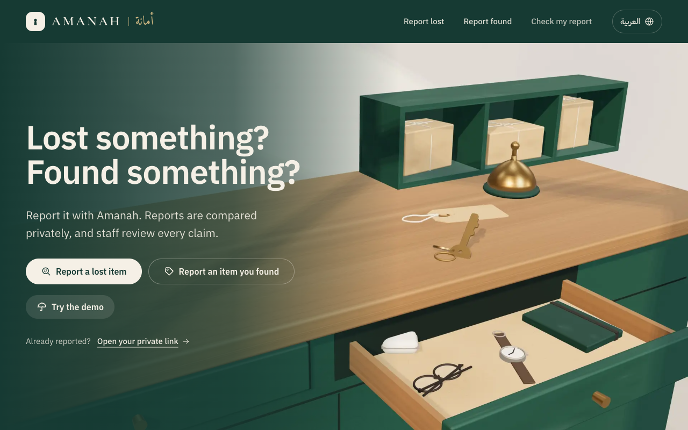

# Amanah | أمانة

Amanah is a privacy-first lost-and-found service for one organisation, such as a campus, venue, or office. People report items they lost or found. The server compares the reports privately, and Gemini suggests possible matches. When a lost item may have been found, its owner answers a couple of ownership questions on a private tracking link. Staff review every claim and make the final decision. Found-item details are never shown on any public page. The site is bilingual (Arabic by default, English one switch away).



## Try the demo

Open `/demo` (for example `http://localhost:3000/demo` after `npm run dev`). It is an interactive prototype: you play the owner of a blue umbrella lost in the library, answer one ownership question, and see a simulated staff decision.

It runs entirely in the browser with fictional data. It needs no Supabase, no Gemini, and no sign-in.


The live site is https://amanahz.vercel.app, and the guided demo is at https://amanahz.vercel.app/demo.

## Setup

Requires Node 20.9 or newer (the minimum for Next.js 16).

```sh
npm install
cp .env.example .env.local
npm run dev
```

`npm run dev` serves http://localhost:3000. Fill in `.env.local`:

| Variable | Purpose |
| --- | --- |
| `NEXT_PUBLIC_SUPABASE_URL` | Your Supabase project URL. |
| `NEXT_PUBLIC_SUPABASE_PUBLISHABLE_KEY` | Supabase publishable key, used by the browser and the auth session check. |
| `SUPABASE_SECRET_KEY` | Supabase server key. Server only; saves reports and runs matching. |
| `GEMINI_API_KEY` | Google Gemini key for matching and ownership questions. Server only. |
| `GEMINI_MODEL` | Gemini model name. `.env.example` sets `gemini-3.5-flash-lite`, which is also the default. |

Never commit `.env.local`. Then apply the SQL files in `supabase/migrations/` in filename order, for example with the Supabase CLI (`supabase migration up` for a local database, `supabase db push` for a linked project).

### Local fixture mode

To run the whole app locally without Supabase or Gemini:

```sh
npm run dev:fixtures
```

This serves http://localhost:3100 with fictional in-memory data, including `/admin`. See [docs/local-fixtures.md](docs/local-fixtures.md) for the sample tracking links and what each screen shows.

## Checks

```sh
npm test
npm run lint
npx tsc --noEmit
npm run build
```

## Staff workspace

`/admin` is for local development only. The proxy (`src/proxy.ts`) returns 404 for `/admin` in any non-development environment, including production, until authenticated staff access exists.

## Usage limits

The server caps how often the app can be used. The caps are constants in `src/utils/limits/usageBuckets.ts`:

| Limit | Value |
| --- | --- |
| Reports per IP address, per UTC hour | 8 |
| Reports per IP address, per UTC day | 30 |
| Gemini requests, whole app, per UTC day | 300 |
| Gemini requests per IP address, per UTC day | 120 |
| Gemini requests per report, per UTC day | 40 |

One Gemini request counts as one use, including a batch of up to 10 comparisons. IP addresses are stored only as a hash. The counters live in Postgres and are created by the migration `supabase/migrations/20261101140000_usage_limits_and_private_report_inserts.sql`. Apply it before relying on the limits. Until it is applied, the counter function does not exist and submissions fail closed: the report form shows "Amanah is busy right now" and nothing is saved. The same migration also stops anonymous clients from inserting reports directly, so every report goes through the submission limit.

Fixture mode always allows requests, so these limits are not exercised there.

## Documentation

- [docs/ai-matching.md](docs/ai-matching.md): how Gemini compares reports, scoring, automatic matching, monitoring.
- [docs/ownership-verification.md](docs/ownership-verification.md): ownership questions and the staff decision.
- [docs/local-fixtures.md](docs/local-fixtures.md): running locally with fictional data.
- [docs/design-guidelines.md](docs/design-guidelines.md): palette, type, and component rules.
- [PRODUCT.md](PRODUCT.md): who Amanah is for and the promises every screen keeps.
