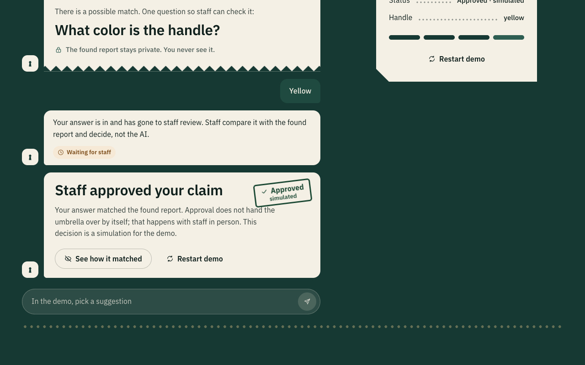

# Amanah (أمانة) · Privacy-first lost and found

> Report what you lost or found. Amanah compares the reports privately, and staff decide who the item goes back to.

**Live:** https://amanahz.vercel.app · **Guided demo:** https://amanahz.vercel.app/demo

A lost-and-found desk usually has two bad options: put found items on a public list, where anyone can claim a wallet by describing it from the photo, or keep everything in a notebook that nobody can search. Amanah is a lost-and-found service for one organisation, such as a campus, venue or office, that does neither. People report what they lost or found. The server compares each new report with the opposite kind through **Google Gemini**, without ever showing found items publicly. When a lost item may have been found, the owner answers a couple of ownership questions on a private tracking link, and **staff make the final decision**.

The site is bilingual: Arabic (RTL) by default, with English one switch away. It works on phones and desktops.

*Amanah* is something entrusted to you, to keep safe and to return: «كل مفقود أمانة».


> ⚠️ **Status:** Amanah is an MVP. AI suggestions are not ownership decisions, and the similarity score is not a probability. The staff workspace (`/admin`) has no sign-in yet, so it runs only in local development. The live site runs in [test mode](#test-mode), where visitors play the staff role on their own test claim; the guided demo and fixture mode use fictional data.

## Features

| Feature | What it does |
| --- | --- |
| 📝 **Lost and found reports** | Short forms for item, description and location, with one example chip per field. Nothing is published, listed or searchable. |
| 🔍 **Private matching** | Each new report is compared automatically with up to 10 opposite-type reports per Gemini request. Staff can also run a check by hand, one pair per request. Every pair is marked `match`, `insufficient_information` or `no_match`, with a 0–100 similarity score that only orders suggestions for staff. |
| 🔗 **Private tracking link** | The lost reporter gets `/report/track#…`, a random credential kept in the URL fragment. It shows only that report's progress: checking, a possible match, no confirmed match so far (some reports were too vague to judge), no match so far, or checking did not finish. A found reporter gets a confirmation and drop-off guidance, never a match result. |
| 🗝️ **Ownership questions** | For a possible match, Gemini writes up to two open questions about details that appear only in the found report. Questions that reveal the answer are dropped. The owner never sees the found report. |
| 🧑‍💼 **Staff decision** | Staff see the suggestion, the evidence and the owner's answers. They approve the claim for hand-over follow-up, reject it, reset it, or ask a follow-up question. Every decision is added to a log, never overwritten. Staff can also review lower-confidence pairs and link two reports by hand. |
| 📊 **Monitoring** | Counts and times only: unchecked pairs, check failures, claims waiting, and the staff approval rate by score band. No report text, IDs or answers. |
| 🎬 **Guided demo** | `/demo` runs in the browser with fictional data. You play the owner of a blue umbrella lost in the library, answer one question, and see a simulated staff decision. |
| 🧪 **Test mode** | The live site runs as a public test version: tap an example to fill the lost form, get a real possible match against sample reports, answer the ownership questions, then approve or reject your own claim as staff to see both outcomes. Test reports are deleted after 3 days. See [Test mode](#test-mode). |



## Architecture

```
Browser (Next.js + Tailwind, Arabic RTL / English)
   │  submitReport(form)                  → server action
   │  continueMatching(credential)        → server action, called step by step
   │  ownership answers (track page)      → server actions, lost-report credential only
   │  /admin (local only)                 → run matching, review pairs, decide claims
   ▼
Next.js server (Vercel)
   ├─ src/proxy.ts → /admin returns 404 outside development
   ├─ Validation: item ≤ 200, description ≤ 2000, location ≤ 500 characters
   ├─ Usage limits in Postgres (consume_usage): reports per IP, Gemini calls per app / IP / report
   ├─ Supabase (server key only): reports, report_submissions (credential hash), report_pair_checks,
   │                              report_matches, report_candidate_reviews, ownership_*,
   │                              matching_runs, usage_counters
   └─ src/utils/gemini → Gemini (default gemini-3.5-flash-lite)
                         ├─ JSON Schema response format, then checked again on the server
                         ├─ automatic: up to 10 candidates per request, sent as C1…C10, never IDs
                         ├─ staff run: one pair per request, up to 4 pairs per run
                         ├─ 20 s timeout (30 s for a batch), one retry on 500/502/503/504
                         └─ any invalid answer: nothing is saved and the pairs are retried later
```

The browser only ever receives a phase (`checking`, `complete`, `failed`, `rate_limited`, `unavailable`) and, for lost reports, an outcome (`possible_match`, `uncertain`, `no_match`). It never receives found-item details, scores, explanations, IDs or counts. Keys stay in server environment variables.

## Privacy model

- **No public gallery.** Found-item details are never shown on a public page. A lost reporter never sees a list of found items.
- **The link is the key.** The tracking credential is 32 random bytes (`base64url`). Only its SHA-256 hash is stored. It lives in the URL fragment, so it never appears in request URLs, server logs or `Referer` headers. The page passes it to server actions, which hash it and look it up, and may keep it in `sessionStorage` for that tab.
- **Report text is data.** Matching sends Gemini only item name, description and location. Checking an ownership answer also sends the questions, the found-report detail behind each one, and the owner's answer. Everything is sent as data, never as instructions.
- **Database first.** Row-level security is on for every table, and the publishable key cannot read reports, matches or pair checks. Anonymous clients cannot insert reports directly, so every report goes through the submission limit.
- **Staff decide.** An AI suggestion is saved as "pending review". Approval means staff will continue the hand-over in person, not that the item is returned.

## What Gemini returns

Each response must match a JSON Schema sent with the request (`src/utils/gemini/`). The server then checks it again.

**Report comparison** (`compareReports.ts`):

```json
{
  "decision": "match | insufficient_information | no_match",
  "reason": "short explanation",
  "supporting_details": ["detail stated in both reports"],
  "contradictions": ["detail that clearly conflicts"],
  "missing_information": ["detail stated in only one report"],
  "similarity_score": 0
}
```

`similarity_score` is an integer from 0 to 100. Each list holds at most 5 items. A `match` with no supporting detail, or with any contradiction, is saved as `insufficient_information`. A batch answer wraps these in `{ "results": [{ "candidate": "C1", ... }] }`, and one missing, repeated or invalid item rejects the whole batch.

**Ownership questions** (`ownershipVerification.ts`):

```json
{
  "questions": [
    { "detail": "hidden detail from the found report", "question": "open question", "answer_keywords": ["1 to 5 keywords"] }
  ]
}
```

**Answer assessment:**

```json
{ "assessment": "supports | unclear | conflicts", "explanation": "for staff only" }
```

There are at most two questions. A question is dropped if it reveals its answer, is not grounded in the found report, or asks about something the lost report already says. If none survive, the claim goes straight to staff review.

The decision rules, score guidance and monitoring are documented in [docs/ai-matching.md](docs/ai-matching.md). Ownership questions and staff decisions are documented in [docs/ownership-verification.md](docs/ownership-verification.md).

## Error handling

| Case | What the person sees |
| --- | --- |
| Empty or too-long field | A message next to that field. Nothing is saved and no usage is counted. |
| Report limit reached, or the usage counter is unavailable | "Amanah is busy right now. Your report was not saved." The limit fails closed. |
| Gemini rate limit (429), daily Gemini cap, or the usage counter is unavailable | "Checking is paused" and an automatic retry after 60 seconds, at most twice. Then "checking could not finish", with **Try again**. |
| Gemini timeout, error or malformed answer | "Your report is saved, and this is not a 'no match' result." No pair is recorded as checked. |
| Gemini key missing | "Reports cannot be compared at the moment." |
| Checking still unfinished after 40 rounds | "Checking is taking longer than expected", with a refresh to continue. |
| Unknown or malformed tracking link | "This link doesn't open", with nothing that hints whether a report exists. |
| Migration not applied | Staff screens name the missing migration instead of failing silently. |

Errors and unchecked pairs are never counted as `no_match`. "No match so far" appears only when every relevant pair has a recorded check.

## Usage limits

The caps are constants in `src/utils/limits/usageBuckets.ts`:

| Limit | Value |
| --- | --- |
| Reports per IP address, per UTC hour | 8 |
| Reports per IP address, per UTC day | 30 |
| Gemini requests, whole app, per UTC day | 300 |
| Gemini requests per IP address, per UTC day | 120 |
| Gemini requests per report, per UTC day | 40 |

One Gemini request is one use, including a batch of up to 10 comparisons. IP addresses are stored as a SHA-256 hash with no secret, which keeps them out of plain sight but is not anonymisation. The counters are created by `supabase/migrations/20261101140000_usage_limits_and_private_report_inserts.sql`. Until it is applied, submissions fail closed and nothing is saved. Fixture mode always allows requests.

## Test mode

Set `AMANAH_SANDBOX=1` to run a public test version. **Use it only on a database that holds test data:** it treats every report as a visitor's test.

- Eleven sample found reports in Arabic and English (`src/utils/sandbox/samples.ts`) are always kept, so a visitor reporting a lost umbrella, wallet or keys gets a possible match and real ownership questions.
- On a claim waiting for staff, the visitor can play the staff role on their own claim (approve, or switch to reject) to see what the owner sees. The page labels this as simulated.
- Every other report is removed by the next daily cleanup once it is 3 days old, with its matches and claims. A claim linked to an expired found report goes with it.
- Vercel Cron calls `GET /api/sandbox/cleanup` daily (`vercel.json`) with `Authorization: Bearer $CRON_SECRET`, and the route answers with counts only. `POST /api/sandbox/cleanup?purge=all` with the same header removes every non-sample report at once, for a deliberate clean.
- Apply `supabase/migrations/20261124120000_sandbox_report_cleanup.sql` before the first cleanup.

Without the setting, the route does not exist and only staff decide.

## Project structure

```
src/
  app/
    page.tsx                  # homepage
    demo/                     # guided demo, browser only, fictional data
    report/lost/ report/found/ # report forms
    report/actions.ts         # submitReport, continueMatching
    report/track/             # private tracking page and ownership answers
    admin/                    # local staff workspace: claims, matches, reports, monitoring
  components/                 # site header, shared controls, icons
  i18n/                       # Arabic / English messages and locale switching
  proxy.ts                    # Supabase session, /admin hidden outside development
  utils/
    gemini/                   # comparison and ownership prompts, schemas, checks
    matching/                 # batching, pair tracking, credentials, public status
    ownership/                # ownership questions, answers and staff decisions
    limits/                   # usage buckets and the consume_usage call
    monitoring/               # aggregate counts for the staff dashboard
    fixtures/                 # in-memory Supabase and Gemini for local fixture mode
supabase/migrations/          # schema, row-level security and grants, in filename order
tests/                        # node:test suites for matching, ownership, limits, monitoring, fixtures
art-src/                      # source and render script for the homepage 3D artwork
docs/                         # matching, ownership, fixtures and design guidelines
```

## Running locally

Requires Node 20.9 or newer.

```sh
npm install
cp .env.example .env.local
npm run dev
```

`npm run dev` serves http://localhost:3000 on this machine only (it uses your real keys, so it is not reachable from your network). Fill in `.env.local`:

| Variable | Purpose |
| --- | --- |
| `NEXT_PUBLIC_SUPABASE_URL` | Your Supabase project URL. |
| `NEXT_PUBLIC_SUPABASE_PUBLISHABLE_KEY` | Publishable key, used only by the session check in `src/proxy.ts`. |
| `SUPABASE_SECRET_KEY` | Server key. Server only; saves reports and runs matching. |
| `GEMINI_API_KEY` | Gemini key for matching and ownership questions. Server only. |
| `GEMINI_MODEL` | Optional. Defaults to `gemini-3.5-flash-lite`. |

Never commit `.env.local`. Apply the SQL files in `supabase/migrations/` in filename order, for example with `supabase migration up` (local) or `supabase db push` (linked project).

### Fixture mode, no accounts needed

```sh
npm run dev:fixtures
```

This serves http://localhost:3100 with fictional in-memory data, including `/admin`, and needs no Supabase or Gemini. [docs/local-fixtures.md](docs/local-fixtures.md) lists the sample tracking links and what each screen shows.

### Checks

```sh
npm test            # node:test suites
npm run lint
npx tsc --noEmit
npm run build
```

## Tech stack

Next.js 16 (App Router) · React 19 · TypeScript · Tailwind CSS 4 · Supabase (Postgres, row-level security) · Google Gemini via `@google/genai` · IBM Plex Sans Arabic and IBM Plex Sans · Vercel

## Credits

- AI model: Google Gemini, used under the [Gemini API terms](https://ai.google.dev/gemini-api/terms)
- Homepage artwork: original 3D renders made with three.js, source in [art-src/](art-src/)
- Fonts: IBM Plex Sans Arabic, IBM Plex Sans, Cormorant Garamond and Amiri, all under the SIL Open Font License

## Limitations

- Matching runs while the submitter's page or the lost report's tracking link is open. Pairs left unchecked stay unchecked, never "no match", until a later report or a staff run covers them.
- Report text and owner answers are processed by Google's Gemini API, so Google's data-use terms for your plan apply.
- The similarity score is not calibrated. Gemini can score the same pair differently on different runs.
- Anyone who has a tracking link can see that report's progress, and a link cannot yet be revoked.
- Per-IP limits trust the first `x-forwarded-for` address. That is safe behind Vercel, which sets it; behind another host, a visitor could set it and avoid the per-IP caps.
- `/admin` has no sign-in, so it runs only in development, and staff identity is not recorded with decisions.
- There are no email or SMS notifications, and the organisation's hand-in contact point is still to be configured.

## More documentation

- [PRODUCT.md](PRODUCT.md): who Amanah is for, the flow, and the promises every screen keeps
- [docs/design-guidelines.md](docs/design-guidelines.md): palette, type and component rules
- [docs/ai-matching.md](docs/ai-matching.md): decision rules, scoring, automatic matching, monitoring
- [docs/ownership-verification.md](docs/ownership-verification.md): ownership questions and the staff decision
- [docs/local-fixtures.md](docs/local-fixtures.md): running locally with fictional data

---

Built by [Mohammed Bin Shamlan](https://github.com/mobinshamlan)
